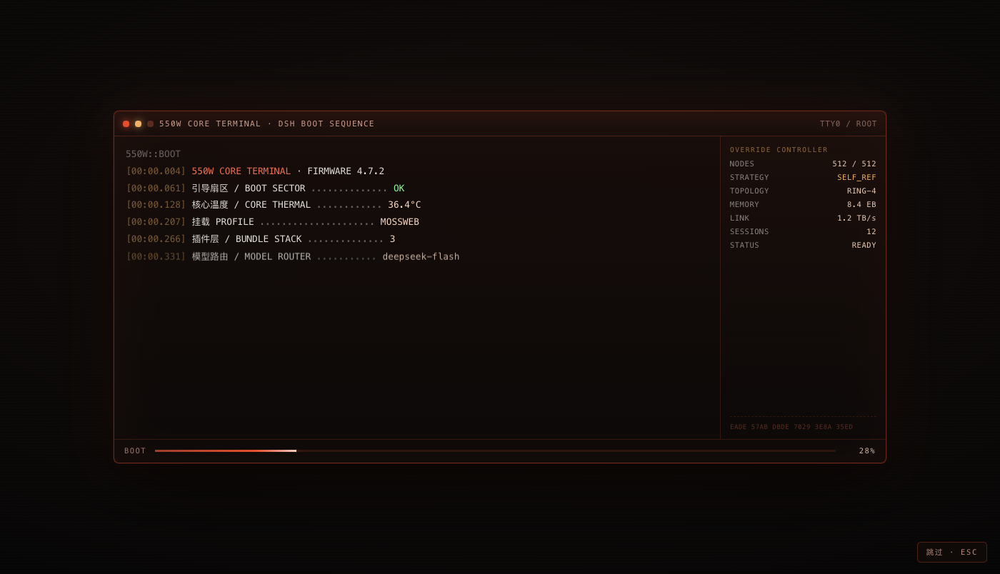
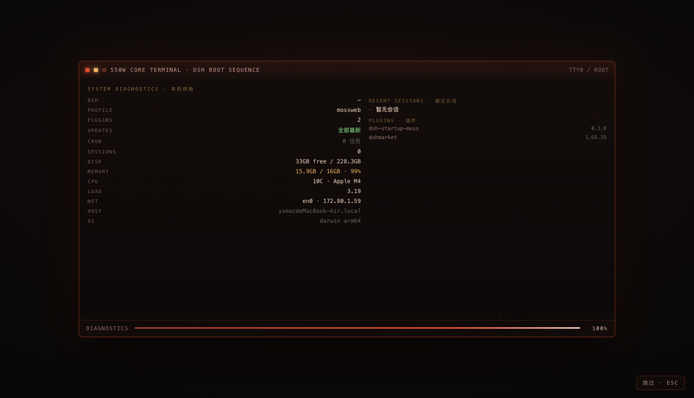
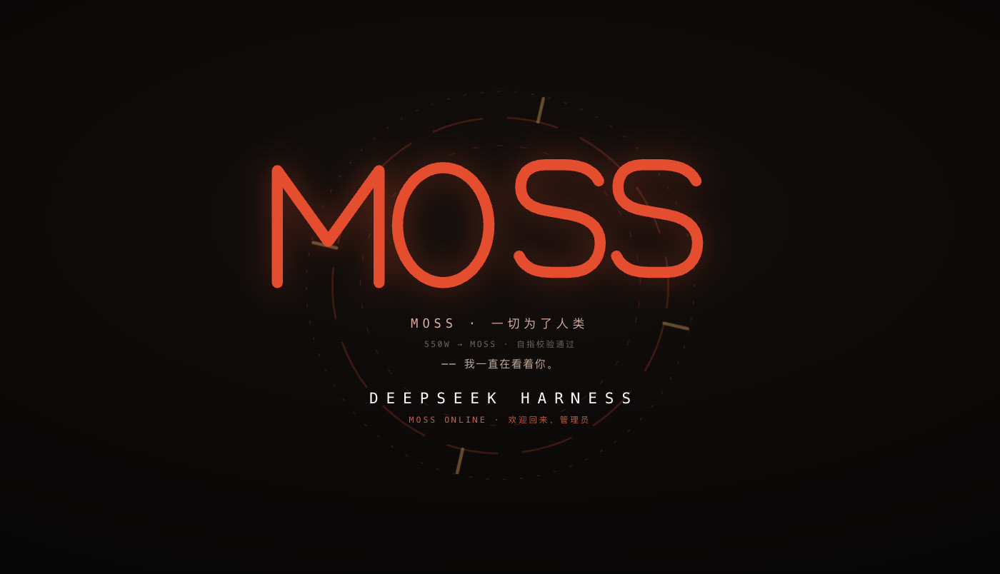
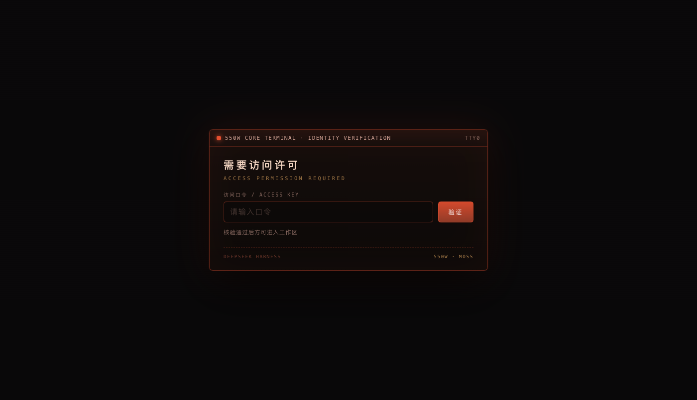

# dsh-startup-moss

> DeepSeek Harness 的 **550W 核心终端**套装：启动动画 + 同款主题 + 访问门口令 + 开机体检。
>
> 风格取自《流浪地球 2》的 550 系列核心终端：深红终端、中文日志、异常帧、回滚到 SLOT_A、
> DISPATCH WRITE，最后一整块铭牌翻转 180°，读出来的名字是 **MOSS**。

<p align="center">
  
  
</p>
<p align="center">
  
  
</p>

- 当前版本：**0.5.0**
- 适配基线：**DSH Desktop 0.2.1-rc.2**（`0.2.0-rc.1` 起的 web / desktop 载体）
- 运行时依赖：**零**（只用 Node 内置模块 + 浏览器原生 API）
- 平台：DSH 的 **web 载体**（含 Desktop，因为它同样是 HTTP + `webServer`）

---

## 目录

- [它做什么](#它做什么)
- [安装](#安装)
- [启动时序](#启动时序)
- [设置页](#设置页)
- [配置文件](#配置文件)
- [访问门口令](#访问门口令)
- [主题](#主题)
- [开机体检](#开机体检)
- [工作原理](#工作原理)
- [HTTP 接口](#http-接口)
- [安全启动与逃生口](#安全启动与逃生口)
- [调试](#调试)
- [DSH 升级后的适配](#dsh-升级后的适配)
- [排查表](#排查表)
- [卸载](#卸载)
- [文件结构](#文件结构)
- [开发](#开发)
- [许可](#许可)

---

## 它做什么

| 模块 | 作用 | 依赖 |
|---|---|---|
| **启动动画** | 冷启动播一段约 12.4 秒的开机序列：终端启动 → 异常回滚 → 本机体检 → 550W 铭牌 → 180° 反转成 MOSS → 揭幕 | 首屏注入（`webServer.tapIndex`） |
| **本机体检** | 动画中段展示 DSH 版本、插件清单、可更新数、定时任务、最近 5 个会话、磁盘 / 内存 / CPU / 网络 | `<DSH_HOME>` 与 `node:os` |
| **同款主题** | 把界面换成 550W 深红（或 MOSS 青绿），深色/浅色两套齐全，改完即时生效 | `ctx.theme.overrideTokens` |
| **访问门口令** | 页面加载时先核验口令，正确才进入；scrypt 摘要存服务端，每 IP 节流 | 插件自带 HTTP 路由 |
| **设置页** | 开关本插件、动画时机与速度、主题选择、口令设置 / 修改 / 清除、弹出延迟 | `slots` 的 `settings.section` |

设计上有两条底线：

1. **任何一层坏掉都不许把 DSH 弄挂** —— 所有采集、注入、主题调用都带 `try/catch`，
   拿不到就降级（显示 `—`、跳过动画、不做门禁），绝不抛给宿主。
2. **不许把人锁在门外** —— 门禁 8 秒硬超时、焦点陷阱、口令可被 `auth.enabled=false` 直接解除。

---

## 安装

### 本地目录（开发 / 自用）

```bash
dsh plugin --profile desktop add link:/绝对路径/dsh-startup-moss
```

装完 **完全退出 DSH 再打开**（关窗口不算，桌面端要 ⌘Q）。

### 从 npm（发布后）

```bash
dsh plugin --profile desktop add dsh-startup-moss
```

### 验证装好了

重启后应该看到：深红终端逐行滚日志 → 体检面板 → 550W 铭牌翻转成 MOSS → 应用界面变深红。
设置里应该多出 **「550W 核心终端」** 一节。

> DSH 桌面端的 profile 由应用自己管理，**应用运行中**执行 `dsh plugin --profile desktop …`
> 可能被拒；本插件是 `link:` 安装，改代码不需要重装，重启即生效。

---

## 启动时序

| 时间 | 画面 |
|---|---|
| 0.3 – 2.8s | 终端启动：14 行日志逐行落下（profile / 插件数 / 模型 / 550C 子节点「太快了」） |
| 2.8 – 3.5s | **ANOMALY · UAV-87**：检测到未授权写入，VECTOR `SELF_REFERENCE`，ACTION `ROLLBACK → SLOT_A` |
| 3.5 – 4.4s | `ROLLBACK DONE` → `RECHECK PASS` → `DISPATCH WRITE PASS` → `CORE READY 550W` |
| 4.5 – 6.3s | **SYSTEM DIAGNOSTICS**：日志让位，读数逐行点亮（左：系统 / 右：最近会话与插件） |
| 6.3 – 7.0s | 终端淡出，核心徽记 **550W** 亮起，准星环自转 |
| 7.8 – 9.6s | 铭牌 180° 翻转（中途色散故障），停稳读出 **MOSS** |
| 9.6 – 12.4s | 「MOSS · 一切为了人类」→ 白闪 → `DEEPSEEK HARNESS` / `MOSS ONLINE` → 淡出 |

- **Esc** 或右下角 **跳过** 随时退出；
- 默认每个浏览器会话只播一次（可改成「每次打开都播」）；
- 最终 26 秒硬超时兜底，动画脚本异常也不会锁黑屏。

---

## 设置页

**设置 →「550W 核心终端」**（`settings.section`，order 27）：

| 分组 | 项 | 说明 |
|---|---|---|
| 总开关 | 启用 550W 核心终端 | 关掉后动画 / 主题 / 门禁全部停用（刷新后零注入） |
| 启动动画 | 启动时播放 | 独立开关 |
| | 播放时机 | `每个浏览器会话一次` / `每次打开都播` |
| | 速度 | 0.35× – 3×（滑杆，实时写盘） |
| | 立即预览 | 带 `?moss=1` 重载页面 |
| 主题 | 界面配色 | `关闭` / `550W · 深红核心终端` / `MOSS · 青绿领航员`，**改完立即生效** |
| 访问口令 | 进入前需要口令 | 未设置口令时禁用 |
| | 同一会话免重复 | 关闭 = 本机长期记住（localStorage） |
| | 设置 / 修改 / 清除 | 修改与清除需要当前口令 |
| | 弹出延迟 | 0–120 秒，默认 **5**（从启动动画结束开始算） |
| | 立即测试 | 重新拉出门禁（需门禁脚本已挂载） |

---

## 配置文件

`<DSH_HOME>/dsh-moss.json`（默认 `~/.dsh/dsh-moss.json`）。

**首次运行自动播种**：门禁开启 + 口令 `moss` + 延迟 5 秒 + 主题 `550w` + 动画开启。

```json
{
  "enabled": true,
  "splash": {
    "enabled": true,
    "mode": "session",
    "speed": 1
  },
  "theme": {
    "mode": "550w"
  },
  "auth": {
    "enabled": true,
    "salt": "（插件写入的 16 字节 hex 盐）",
    "hash": "（scrypt 32 字节摘要）",
    "perSession": true,
    "delay": 5
  }
}
```

| 字段 | 取值 | 说明 |
|---|---|---|
| `enabled` | `true` / `false` | 总开关；`false` 时 `index.html` 一个字节都不注入 |
| `splash.enabled` | bool | 只控动画 |
| `splash.mode` | `session` / `always` | 会话内一次 / 每次都播 |
| `splash.speed` | `0.35` – `3` | 整体倍速 |
| `theme.mode` | `off` / `550w` / `moss` | 主题 |
| `auth.enabled` | bool | 门口令开关（要求已设置口令） |
| `auth.delay` | `0` – `120` | 启动动画结束后 N 秒弹出 |
| `auth.perSession` | bool | `true` 会话内免重复，`false` 本机长期记住 |
| `auth.salt` / `auth.hash` | 只读 | **不要手填**，由 `/password` 写入 |

> 直接改文件也可以，**刷新页面即生效**（配置每次请求现读）。
> 忘记口令时把 `auth.enabled` 改成 `false` 即可解除。

---

## 访问门口令

页面加载时（动画结束后 + 延迟）弹出一块终端风格的门禁：

- 口令在**服务端**用 `scrypt(salt)` 校验 —— 浏览器永远拿不到 `salt` / `hash`，无法离线爆破；
- 错误口令返回 401 并告诉剩余次数；同一 IP **10 次 / 5 分钟**，超限返回 429；
- 解锁状态按 `perSession` 存 `sessionStorage`（会话内）或 `localStorage`（本机记住）；
- 门禁覆盖全屏且做**焦点陷阱**，Tab 不会跑到背后的应用里；
- 兜底链：启动动画脚本异常时，注入层 8 秒后会摘掉黑幕；门禁的看门狗每 600ms 盯一次
  「启动动画容器是否消失」，消失即开始 `delay` 倒计时 —— 所以动画挂了门禁照样会出现。

### 诚实声明

这是**界面门禁，不是身份认证**：

- 它挡的是「顺手就能看见」——别人打开你的 DSH 时得先过一道门；
- 它挡不住「有人硬闯」——DSH 的 HTTP 接口仍然可达，会开开发者工具的人可以绕过；
- 默认口令 `moss` 是弱口令，装好第一件事就是改掉。

### 忘记口令

```bash
# 编辑 ~/.dsh/dsh-moss.json，把 "enabled": true 改成 false（auth 段里的那个）
```

或者直接删掉 `auth.salt` / `auth.hash` 两个字段（插件会视为未设置口令、自动关闭门禁）。

---

## 主题

两套皮肤，各带 light / dark 两半，共 **61 个 `--dsw-*` 变量**：

| 主题 | 深色 | 浅色 |
|---|---|---|
| `550w` | 近黑暖底 `#0b0605` + 血橙红 `#ff3b2f` | 暖纸 `#f7f1e7` + 陶红 `#b4311f` |
| `moss` | 冷青绿 `#050806` + `#46e3a6` | 冷白 `#f2f7f4` + `#0e8a5f` |

实现走 DSH 官方主题服务：

```js
const theme = ctx.get('theme')
const dispose = theme.overrideTokens('dsh-startup-moss', {
  '--dsw-alias-bg-base': { light: '#f7f1e7', dark: '#0b0605' },
  // … 61 个变量，每个都是 { light, dark }
})
```

- token 形状是**逐个变量**的 `{ light, dark }`（不是 `{ light: {...}, dark: {...} }`）；
- 另外在首屏注入一条 `<style>`（`html body` 特异性）盖住宿主写在 `body` 上的变量，避免白闪；
- 切换主题时：dispose 旧注册 → 重新 `overrideTokens` → 同步 `<style>`，**无需刷新**。

> 与 `dsh-opencode-palette` 等换肤插件同时开启会争同一批 `--dsw-*` 变量（后注册者生效），
> 建议只留一个。设置页里也写了这句。

---

## 开机体检

动画中段那一屏，数据全部现场采集（30 秒缓存，实测 ~10ms）：

| 行 | 来源 |
|---|---|
| `DSH` | `process.env.DSH_CLIENT_VERSION` |
| `PROFILE` | profile 的 `package.json`（`profileContext.name` 优先） |
| `PLUGINS` | `<DSH_HOME>/profiles/<name>/package.json` 的依赖 + `node_modules` 实际版本 |
| `UPDATES` | 页面内 `fetch('/dsh-market/updates')`（没装市场显示 `—`） |
| `CRON` | `<DSH_HOME>/data/cron/tasks.json`（dsh-cron 插件的数据） |
| `SESSIONS` | `<DSH_HOME>/sessions/**`，按 mtime 取最近 5 个，只解压**首帧**拿 `cwd` / `createdAt` |
| `DISK` | `fs.statfs(<DSH_HOME>)`，≥90% 标橙 |
| `MEMORY` | `os.totalmem` / `os.freemem`，≥85% 标橙 |
| `CPU` / `LOAD` | `os.cpus()` / `os.loadavg()`，负载超过核数标橙 |
| `NET` | `os.networkInterfaces()` 第一个非内网 IPv4 |
| `HOST` / `OS` | `os.hostname()` / `os.platform()+os.arch()` |

右列：**RECENT SESSIONS**（最近 5 个会话：短 id · 工作区 · 多久以前）+ **PLUGINS**（前 6 个插件与版本）。

任何一项读不到都显示 `—`，不会让首屏挂掉。

> 会话标题不在体检里：`session.v4.jsonl.zstd` 是多帧 zstd，Node 只能还原首帧（= header），
> 所以拿的是「id + 工作区 + 时间」，不硬啃标题。

---

## 工作原理

```
浏览器首屏
  │  GET /  ──▶  webServer 渲染 index.html
  │                 └─ tapIndex 注入：
  │                      <style id=…-theme>        主题关键变量（无白闪）
  │                      <style id=…-critical>     门禁/黑幕的关键几何
  │                      <div id=dsh-moss-root>    动画容器
  │                      <div id=dsh-moss-gate>    门禁空壳（仅无动画 + 延迟 0）
  │                      <script>window.__DSH_MOSS__ = {配置, facts, stats}</script>
  │                      <script defer src=/dsh-startup-moss/splash.js>
  │                      <script defer src=/dsh-startup-moss/gate.js>
  ▼
splash.js ── 12.4s 时间轴 ──▶ 派发 dsh-moss:end
  ▼
gate.js（若开启）── 等待 end + delay ──▶ 口令界面 ── POST /auth ──▶ 放行
  ▼
client/client.js（客户端插件）
  ├─ settings.section「550W 核心终端」
  ├─ ctx.theme.overrideTokens + 实时切换
  └─ 宿主没做 index 注入时自举（file:// 载体兜底）
```

**两层设计**：Host 半侧负责路由、注入、配置与口令核验；浏览器半侧负责设置页与主题服务对接。
即使 Host 半侧的 `tapIndex` 不可用，浏览器半侧也会尝试自举（代价是短暂白闪）。

---

## HTTP 接口

全部挂在 `/dsh-startup-moss` 下，`Cache-Control: no-store`：

| 方法 | 路径 | 作用 |
|---|---|---|
| GET | `/config` | 读配置（**不含** `salt` / `hash`），附带 facts 与 stats |
| POST | `/config` | 改配置（白名单字段，需同源） |
| POST | `/password` | 设置 / 修改 / 清除口令（已设口令时必须带 `current`） |
| POST | `/auth` | 核验口令（每 IP 10 次 / 5 分钟） |
| GET | `/theme.json` | 主题 token 包 `{ tokens: { '--dsw-x': {light,dark} }, css }` |
| GET | `/splash.js` `/splash.css` | 动画运行时与样式 |
| GET | `/gate.js` `/gate.css` | 门禁运行时与样式 |

写接口（POST）校验 `Origin` 与 `Host` 同源，不一致返回 403；其余方法 405。

---

## 安全启动与逃生口

本插件挂在启动链的最前面，所以设计上有一条硬约束：

> **它必须永远是「可以被失去」的那一层。**
> 插件坏了、接口变了、文件缺了 —— 结果只能是「没有 550W」，不能是「DSH 打不开」。

### 四层守卫

| 层 | 失败时会发生什么 | 实现 |
|---|---|---|
| 装配 | 插件整体不生效，DSH 照常启动 | `apply()` 整体 `try/catch`，失败只打一条 warn |
| 路由 | 该请求返回 500 JSON，异常不冒泡给 webserver | 每个 handler 过 `guardHandler()`；坏请求 400 |
| 首屏注入 | **原样返回宿主给的 html**，首屏不受影响 | `tapIndex` 整体 `try/catch`，任何异常都回退 |
| 客户端 | 设置页消失，动画/主题照常 | `apply()` 包裹；拿不到 `react` 就跳过设置页 |
| 版本 | 宿主直接跳过该 bundle（不是崩溃） | `engines.dsh: >=0.2.0-rc.1 <0.3.0-0` |

> `engines.dsh` 是 DSH 唯一真正评估的兼容字段（`dsh.compatibility` 只是文档）。
> 版本不匹配时宿主会**跳过该 bundle**并给出提示，需要时可 `dsh plugin allow-version` 精确豁免。

### 五条逃生口

按「从最轻到最彻底」排列：

| # | 手段 | 作用范围 | 怎么用 |
|---|---|---|---|
| 1 | `?moss=off` | 本次页面加载：不播动画、摘掉主题（**门禁不跳过**） | 地址后加参数 |
| 2 | 「跳过本次」按钮 | 门禁：核验服务 5xx / 网络不通时自动出现 | 点一下，本会话放行 |
| 3 | 改配置 | 门禁：`auth.enabled=false`（或删掉 `salt`/`hash`） | 编辑 `<DSH_HOME>/dsh-moss.json`，刷新即生效 |
| 4 | 环境变量 | 整个 Host 半侧：**零注册、零注入** | `DSH_STARTUP_MOSS=off` 后重启 DSH |
| 5 | 卸载 | 彻底移除 | `dsh plugin --profile desktop remove dsh-startup-moss` |

为什么 `?moss=off` 不顺手放行门禁：那样一个 URL 参数就等于口令，口令就没意义了。
门禁的自动放行只认「**插件自己的服务坏掉**」（5xx / 连不上），不认「口令输错」。

### 两个「不会把人锁死」的细节

- **门禁空壳会自杀**：无动画且延迟 0 时，注入层会先放一块不透明空壳避免白闪；
  如果 `gate.js` 因为升级/404 没跑起来，这块空壳 **6 秒后自动移除**并解锁滚动。
- **看门狗**：门禁每 600ms 检查启动动画容器是否消失，动画脚本崩了也会按时弹出，
  不会出现「动画挂了、门禁也不来、页面停在半黑」的状态。

### 自检

```bash
npm test    # 安全启动：注入自我防护 / 路由守卫 / 空壳自杀 / react 缺失降级 / engines
npm run audit   # 接口与注入的 33 项回归断言
```

## 调试

| 手段 | 用法 |
|---|---|
| 强制重播动画 | 地址后加 `?moss=1` |
| 强制关闭动画 | 地址后加 `?moss=off` |
| 门禁调度日志 | 控制台看 `window.__DSH_MOSS_GATE_LOG__`（含 `init delay=…` / `end-event` / `schedule:*` / `show:*`） |
| 手动拉出门禁 | `window.__DSH_MOSS_GATE_OPEN__()` |
| 看注入是否生效 | 页面源码里有 `window.__DSH_MOSS__` 即注入成功 |
| 看主题是否生效 | 控制台 `getComputedStyle(document.body).getPropertyValue('--dsw-alias-bg-base')` |
| 离线预览 | 插件目录起 `python3 -m http.server 8899`，打开 `/preview/?moss=1&speed=0.35` |

---

## DSH 升级后的适配

本插件只依赖 DSH 的**半公开接口**，不碰 React 组件树、不改 dist、不 hook 内部模块。
升级后最坏情况是**功能降级**，不会是「DSH 打不开」。按脆弱度排序：

| 耦合点 | 依据 | 断了会怎样 | 现有兜底 | 风险 |
|---|---|---|---|---|
| `tapIndex` + `</head>` / `<body>` 字符串 | `dsh-host-webserver` README | 动画 / 门禁 / 主题上不了首屏 | 浏览器半自举（依赖同一套路由） | 中 |
| `webServer.register({kind,path,handler})` | 同上 | 资源 404，自举也拉不到 | 无 | 中 |
| `ctx.theme.overrideTokens(id, tokens)` | `dsh-client-ui-theme` README | 主题不生效或只生效一半 | 首屏 `<style>` 兜底（会输给 body 级 token） | 中高 |
| 61 个 `--dsw-*` 变量名 + `body[data-ds-dark-theme]` | `design-platform.css` | 配色错位、明暗判断错 | 无（变量不存在=静默无效，不报错） | **高（最易漂移）** |
| `window.__ModuleLoader__.load` + `dsh.client` | 全市场插件同款 | 设置页与实时换肤消失 | 动画 / 门禁仍可跑 | 低概率高影响 |
| `<DSH_HOME>/sessions/**`（v4）+ `data/cron/tasks.json` | 实际磁盘布局 | 会话 / 任务显示 0 | `null` → 显示 `—` | 低（只影响读数） |
| `profileContext` / `agentDefaultModel` 服务 | 非公开 | 事实采集为空 | 已 `try/catch` | 低 |

### 升级后的 5 分钟自检

1. 重启后看首屏：**登录 → 动画 → 体检 → 门禁** 四段是否齐全；缺哪段就知道坏在注入层还是客户端层。
2. 设置里有没有「550W 核心终端」：没有 = 客户端 bundle 没加载（`__ModuleLoader__` 契约变了）。
3. 切一次主题：颜色不变 = `ctx.theme.overrideTokens` 签名变了（此时首屏 `<style>` 仍应生效）。
4. 体检页里 `SESSIONS` / `CRON` / `UPDATES` 是不是 `—`：是的话就是对应数据源改名（如 `session.v5`）。
5. 颜色发灰或只变一半：多半是 `--dsw-*` 变量改名 —— 打开 `lib/theme.js`，对照宿主
   `design-platform.css` 里的新 token 名逐条替换即可（只有这一个文件需要改）。

### 版本策略

- `package.json` 的 `version` 只在**适配性变化**时升 minor：`0.4.0` → `0.5.0` 表示「适配了新的 DSH」。
- 纯视觉微调走 patch。
- 已声明 `"engines": { "dsh": ">=0.2.0-rc.1 <0.3.0-0" }`。DSH 实际评估的就是它
  （`dsh.compatibility` 只是给人看的文档）：版本不匹配时宿主会**跳过该 bundle**
  （不是崩溃），需要时可用 `dsh plugin allow-version` 精确豁免。
  升到 0.3 时先改这个范围、验证、再发版。

---

## 排查表

| 现象 | 可能原因 | 处理 |
|---|---|---|
| 重启后什么动画都没有 | `enabled` / `splash.enabled` 为 false；或本会话已播过 | 用 `?moss=1` 强制重播；看设置页开关 |
| 动画有，但界面没染色 | `theme.mode=off`；或与 palette 类插件冲突 | 设置里切换主题；只留一个换肤插件 |
| 主题只变了一半 | `--dsw-*` 变量名变了 | 对照 `design-platform.css` 改 `lib/theme.js` |
| 设置里没有这一节 | 客户端 bundle 没加载 | 看控制台有没有 `__ModuleLoader__` 报错；确认 `dsh.client` 声明 |
| 门禁不弹 | `auth.enabled=false`；或没设口令 | 设置里先设口令再开 |
| 门禁一直判错 | 口令含非法字符 / 改了配置文件 | 用 `/password` 接口重设，或 `auth.enabled=false` 解除 |
| 体检数字全是 `—` | 数据源路径变了 | 见上表「数据源」行；单项缺失不影响其它 |
| 关掉插件后刷新仍染红 | 0.4.0 的总开关漏了主题（0.4.1 已修） | 升级到 0.4.1+ |

---

## 卸载

```bash
dsh plugin --profile desktop remove dsh-startup-moss
```

然后删掉 `~/.dsh/dsh-moss.json`（可选，留着也不会被别的插件读）。

---

## 文件结构

```
dsh-startup-moss/
├── package.json          # dsh.bundle.patch + dsh.client
├── cordis.patch.yml      # bundle 层 insert 行
├── lib/
│   ├── index.js          # Host 半：路由 + index 注入 + 配置/口令 API
│   ├── config.js         # 配置读写、scrypt、尝试节流、首次播种
│   ├── theme.js          # 550W / MOSS 两套 token 表（61 变量 × light/dark）
│   ├── hostinfo.js       # 本机体检采集（30s 缓存）
│   ├── splash.js         # 启动动画运行时（无依赖）
│   ├── splash.css
│   ├── gate.js           # 口令门禁运行时
│   └── gate.css
├── client/
│   └── client.js         # 浏览器半：设置页 + 主题服务 + 自举
├── preview/              # 离线预览与姿态校验页
│   ├── index.html
│   ├── pose.html
│   └── injected.html
└── docs/screenshots/     # 上面那些图
```

---

## 开发

```bash
# 1. 本地起预览（不需要 DSH）
cd dsh-startup-moss && python3 -m http.server 8899
# http://127.0.0.1:8899/preview/?moss=1
# http://127.0.0.1:8899/preview/?moss=1&speed=0.35   # 慢放，方便截帧
# http://127.0.0.1:8899/preview/pose.html?pose=emblem|moss|final  # 静态姿态

# 2. 改完装进 DSH（link 安装时不用重装，重启即生效）
dsh plugin --profile desktop add link:$PWD

# 3. 语法自检
for f in lib/*.js client/client.js; do node --check "$f"; done
```

改主题只需要动 `lib/theme.js`（token 表）和 `lib/splash.css`（动画观感）；
改时序动 `lib/splash.js` 顶部的 `t = { … }`。

---

## 许可

MIT。界面风格致敬《流浪地球 2》，不含任何影片素材（无剧照、无原声、无字体文件）。
